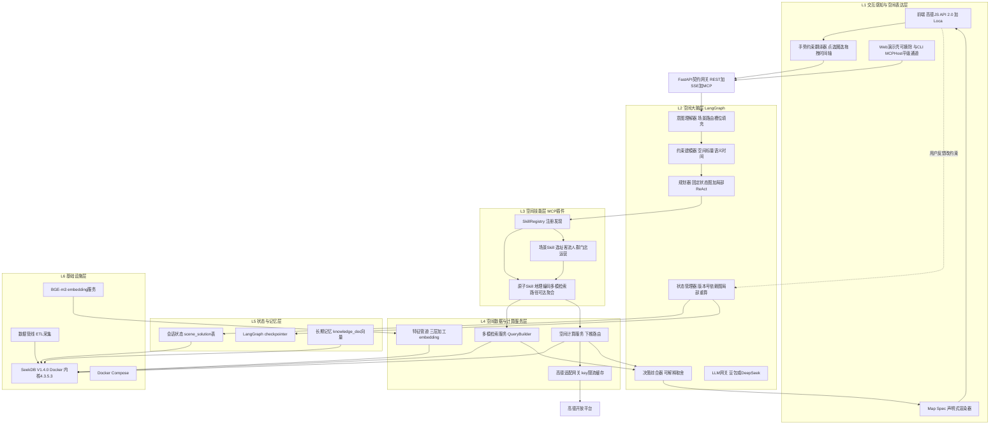
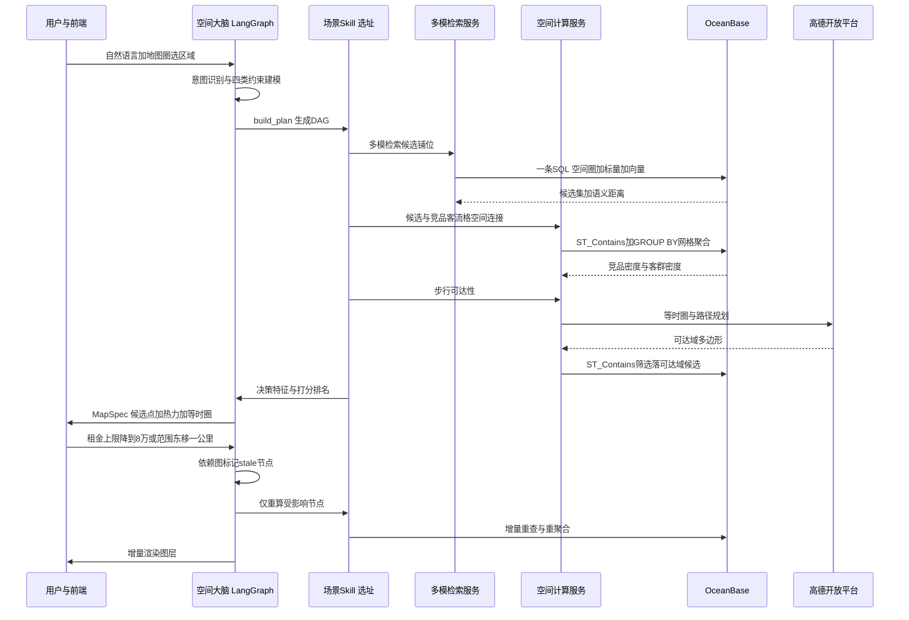
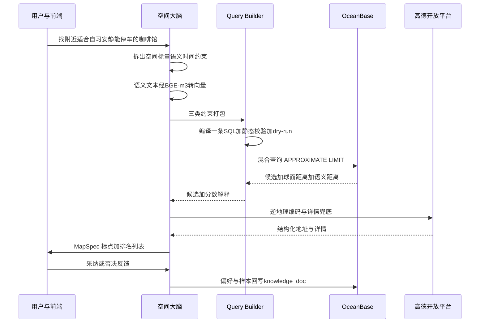
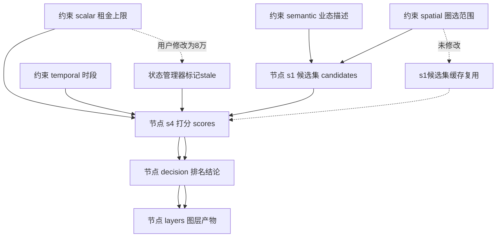

# GeoMind 架构设计文档

> 版本：v1.4（参赛技术方案基线）
> 变更记录：v1.0 初版（六层架构/Schema/Skill 插件/OB 存储/两条时序）；v1.1 新增第 9 章「轻量 Web 演示层设计（可替换壳）」；v1.2 据 SeekDB 实测新增 §6.1、DDL 去 SRID、ADAPTIVE PRE-FILTER、第五模全文；v1.3 环境升级为 SeekDB V1.4.0（Docker 容器，镜像 quay.io/oceanbase/seekdb:latest，内核 4.3.5.3，Built Aug 26 2026），DDL 以 §6.3 正式建表语句为准（SPATIAL KEY/VECTOR KEY/FULLTEXT KEY，禁止 REPLICA_NUM 等分布式选项），V1.4 确认 ST_Intersection/ST_Union_Agg 不存在（ERROR 1305），V1.3 原生实例完整保留为回滚方案；**v1.4（2026-10-15，据 10 万级压测 + 生产库落地）**：§6.3 DDL 增 `lon/lat/grid_id` 冗余列与 `KEY(lon,lat)`/`KEY(grid_id)`/标量复合索引（SPATIAL INDEX 实测完全不参与查询计划，加速路径改由冗余列承担），权威源为 `backend/db/migrations/001_init_schema.sql`（已在 geomind 库实跑）；§6.4 坐实 MBR* 函数不存在、空间连接 10 万级结论与两个绕行方案量化；§6.6 四模 SQL 固化为「MBR 预筛 + ST 精确复核」两段式，坐实全文 MATCH 进入 PRE-FILTER（`pushdown_match_filter`），补生产库四模闭环实测；§6.7 空间聚合改用冗余归属列；§12 地基项 #3 勾选完成。
> 定位：2026 OceanBase 数据库大赛 · 高德赛道 —— AI + 数据库应用开发方向的核心架构交付物
> 读者：开发三人组、答辩评委、后续接手者。本文档精度达到"可直接据此编码"。
> 事实标注约定：【已查证】= 经 OceanBase 官方文档 / 高德官方材料 / 官方仓库逐字核实；【待实测】= 官方文档未承诺或未逐字核实，须在赛题环境用 EXPLAIN / 实跑验证。来源见文末附录。

---

## 1. 设计目标与约束

### 1.1 赛题背景

GeoMind 服务于 **2026 OceanBase 数据库大赛 · 高德赛道**，方向为「AI + 数据库应用开发」。赛道的核心命题是：基于 OceanBase 与高德开放平台，构建一个空间智能体应用，展示 **空间数据处理 + 空间/标量/向量三模混合检索** 能力——即在同一数据库内完成「空间范围过滤（SPATIAL INDEX）+ 业务标量过滤（B-tree）+ 语义相似度召回（VECTOR INDEX/HNSW）」的一条 SQL 混合查询，并把空间计算下推数据库内核（依据：research/03-oceanbase.md §5、§7；官方文旅教程 research/02 §A5）。

**关键不确定性**：截至本文撰写，本届赛题的**具体任务书尚未发布**。这带来一条硬性架构要求——系统必须是**插件化、可扩展**的：赛题落地后新增一个行业场景，不应改动大脑层与数据服务层核心代码，只新增一个 Skill 包（详见第 5 章）。业务语言则对齐高德官方 PDF（research/04）：四大 Skill（客流洞察 / 人群分析 / 智能选址 / 门店运营）、7 步闭环、三层数据加工、"人-时-地-事"知识体系。

### 1.2 设计目标

1. **核心叙事**：同库五模——SeekDB 单引擎内一行记录同时承载「标量属性 + POINT/POLYGON 空间列 + VECTOR 语义向量列 + 全文 + JSON」，一条 SQL 完成空间圈选 + 业务条件 + 语义推荐（关键词召回为补充）。这是区别于"纯调高德 API + 聊天框"的大赛差异化亮点（依据：research/03 §7 结论；SeekDB 实测报告 §1）。
2. **核心产物**：一份**持续更新的结构化空间状态（Spatial State）**，而不是一次性生成的文本报告（高德 PDF P44 原文，research/04 §5.3）。
3. **交互闭环**：地图是一等输入与输出，用户每次圈选/拖拽/改约束触发**依赖图驱动的局部重算**，而非整轮重跑。
4. **可交付形态**：除 Web 应用外，空间能力同时封装为 **MCP Server（Streamable HTTP）**，契合高德官方"Skill / MCP Server"交付形态（research/04 §4、research/02 §A1/B2）。

正因为任务书未知，"插件化"不是锦上添花而是生存策略：我们无法预知评委最终要求客流洞察还是轨迹分析，因此把系统设计成"稳定的六层骨架 + 可热插拔的场景 Skill"。骨架一旦打磨好（多模检索、下推路由、状态闭环、Map Spec），任何新场景都退化为"填一张 Skill 表"的增量工作，而不是推翻重写。这也直接对应高德官方把能力拆成"原子数据层 + 业务 Skill 层"的思路（research/02 §A2），以及 MapAgent 用 Module Inventory 做模块清单注册的做法（research/01 §9）。

### 1.3 四条铁律（不可违反）

1. **空间计算绝不下放给 LLM**：距离 / 包含 / 路径 / 可达性 / 聚合一律由 OceanBase 空间函数或高德 API 完成。LLM 不写坐标、不猜距离、不凭文字判断顺路——这是高德 PDF P41 的原文四原则之一（"不让模型猜距离""不让模型凭文字判断路线是否顺路"，research/04 §5.2）。
2. **状态结构化、增量更新**：对话产物是 Spatial State（JSON），不是自由文本；每次用户修改只重算受依赖图影响的节点（第 4.3 节）。
3. **数据三层抽象后喂 LLM**：基础事实层 Raw Data（POI/客流/轨迹）→ 空间抽象层 Spatial Object（候选集/覆盖/可达域/网格）→ 决策特征层 Decision Feature（评分/排名/标签）。LLM 只消费**决策特征与聚合摘要**，不消费百万行明细（高德 PDF P42 原文，research/04 §5.2；学术侧借鉴 LLMAP"先粗筛后精排"，research/01 §7）。
4. **交互闭环**：地图是一等输出与输入（圈选/拖拽/改约束），渲染方案（Map Spec）也是状态的一部分；用户反馈触发回到闭环第 1/2 步（高德 PDF P44，research/04 §5.3）。

---

## 2. 总体架构

### 2.1 六层总览

系统分六层：L1 交互感知与空间表达层、L2 空间大脑层、L3 空间技能层（MCP 插件）、L4 空间数据与计算服务层、L5 状态与记忆层、L6 基础设施层。设计主线一句话：**以 Spatial State 为核心产物，用 LangGraph 状态图驱动高德"7 步闭环"，把空间计算与多模检索作为确定性 Skill 工具下沉到 OceanBase 与高德 API，LLM 只负责意图理解、约束建模、规划与结果解读。**



### 2.2 逐层说明

**L1 交互感知与空间表达层**
- *前端（高德 JS API 2.0 + Loca）*：渲染点/线/面/热力/等时圈/路线图层，承接地图手势。依据高德 PDF P43"几何表达=点/线/面、数据表达=颜色大小密度、交互表达=框选拖动局部重算"（research/04 §5.2）。
- *手势约束翻译器*：把地图手势（点选、圆圈/多边形圈选、拖拽改范围、时间轴）翻译为结构化空间约束（center/radius/polygon/time_bucket），与文本一起送入大脑。
- *Map Spec 渲染器*：消费 L4 产出的声明式 JSON（图层类型、数据引用、样式、层级），只渲染、不计算。对标 Mapbox MCP 的 `render_map_tool`（research/02 §A3）。

**L2 空间大脑层（LangGraph StateGraph）**
- *意图理解器*：自然语言 + 手势 → 场景识别 + 槽位填充，路由到对应场景 Skill。带置信度，歧义时 `interrupt()` 向用户追问（对标 MCP Elicitation，research/02 §B2）。
- *约束建模器*：生成并维护四类约束——空间约束（几何）、标量约束（业务字段）、语义约束（自然语言→embedding）、时间约束（营业时间/时段）。
- *规划器*：**固定 Plan-and-Execute 状态图骨架 + 仅意图/消歧节点局部 ReAct**。7 步固化为图结构（可审计、不漂移、省 3–5× token），空间计算节点是纯确定性 SQL，不调 LLM（依据 research/02 §B4）。
- *状态管理器*：Spatial State 读写、版本号、依赖图、局部重算调度（DAG 节点 stale 标记）、checkpoint。
- *决策综合器*：把决策特征组织成结论/对比/理由，只输出"可解释的取舍"（高德 PDF P44 第 5 步，research/04 §5.3）。
- *LLM 网关*：模型可插拔（豆包 / DeepSeek，OpenAI 兼容），结构化输出用 Pydantic v2 / JSON Schema 约束，空间相关调用 temperature≈0（借鉴 GeoGPT 可复现范式，research/01 §1）。

**L3 空间技能层（Spatial Skills / MCP 插件层）**
- *原子 Skill*：地理编码、周边/多边形检索、多模混合检索、路径规划、可达性分析、客流聚合、人群画像、评分排名、选址打分、轨迹分析——每个是一个确定性工具。
- *场景 Skill*：智能选址、客流洞察、人群分析、门店运营、文旅行程——由原子 Skill 编排而成（DAG 模板），只写"编排 + 评分口径 + 渲染模板"，不写数据访问。
- *SkillRegistry*：装饰器 + 目录扫描自动发现，启动时汇总并自动暴露为 MCP tools。详见第 5 章。

**L4 空间数据与计算服务层**
- *多模检索服务 Query Builder*：唯一检索出口，把约束编译成一条 SQL（空间 ST_* 过滤 + 标量 WHERE + 向量 ANN 排序 + **全文 MATCH...AGAINST（ngram）谓词**），下推 SeekDB 五模混合。生成后必须经过 SQL 静态校验 + 小样本 dry-run + EXPLAIN 卡点（借鉴 GeoAgent 静态分析 + 执行反馈，research/01 §11）。
- *空间计算服务*：计算路由——能下推的（距离/包含/连接/聚合/缓冲区）走 OB 函数；OB 不支持的（路径规划、实时路况、行政边界、逆地理）走高德 API；结果归一化为统一 Schema。
- *特征管道*：原始事实 → 空间抽象 → 决策特征（离线 ETL + 在线特征计算），负责 embedding 生成。
- *高德适配网关*：统一封装高德 key、限流、缓存、字段归一。

**L5 状态与记忆层**
- *会话状态库*：Spatial State 存 OceanBase 关系表 `scene_solution`（JSON 列 + version），热路径可加 Redis 缓存（可选）。
- *检查点*：LangGraph checkpointer 同库持久化，免费获得会话记忆 / 故障恢复 / HITL（依据 research/02 §B1）。
- *长期记忆*：领域知识、用户偏好、历史方案向量化后仍存 OceanBase `knowledge_doc`（VECTOR 列），**不引第二套向量库**，复用同一套多模检索。

**L6 基础设施层**
- OceanBase SeekDB V1.4.0（内核 4.3.5.3，MySQL 兼容 5.7.25，Docker 容器）：单引擎统一关系 + 空间列 + VECTOR + 全文 + JSON 五模；SPATIAL KEY（存 MBR）+ VECTOR KEY（HNSW cosine）+ FULLTEXT KEY（ngram）。
- 数据管线：POI/门店/客流/轨迹导入脚本与高德采集器，直接复用官方 TravelAssist 数据管道（research/03 §8）。
- Embedding 服务（本地 BGE-m3 或 API）、LLM API、高德开放平台。
- 部署：本地开发与演示统一用 Docker 版 SeekDB V1.4.0（127.0.0.1:2881，§6.1）；V1.3.0 原生实例为回滚方案，OceanBase CE 为对照/可移植备选。

### 2.3 与高德"7 步闭环"及业界架构的映射

**六层 ↔ 高德 7 步闭环**（高德 PDF P44，research/04 §5.3）：

| 7 步闭环 | 架构落点 |
|---|---|
| 1 理解意图 | L2 意图理解器 |
| 2 建立约束 | L2 约束建模器（输入含 L1 手势） |
| 3 生成候选 | L3 Skill 调 L4 多模检索（空间+标量+向量） |
| 4 空间计算 | L4 空间计算服务路由到 OB 空间函数 / 高德 API |
| 5 数据决策 | L4 特征加工 + L2 决策综合器 |
| 6 地图表达 | L4 Map Spec → L1 高德 JS/Loca |
| 7 用户反馈 | L1 采集 → L2 状态管理器局部重算，回到 1/2/4 |

**与外部架构的对应关系**：
- **MapAgent（arXiv 2509.05933，已查证）**：其"顶层 Planner 分解子目标 + 模块清单 Module Inventory + 聚合地图工具 Nearby/PlaceInfo/Route/Trip"对应 GeoMind 的"L2 规划器 + L3 SkillRegistry + 原子 Skill"。差异：MapAgent 空间计算在 Google Maps API 侧、无数据库下推；GeoMind 把同构工具下沉到 OB 内核（依据 research/01 §9）。
- **Mapbox MCP Server（已查证，research/02 §A3）**：其"Turf.js 离线确定性空间算子层（distance/buffer/area/union/centroid）+ render_map_tool + Elicitation 消歧"与 GeoMind 同构——GeoMind 的差异化是把这些算子从客户端 Turf.js **下推为 OceanBase ST_* 函数 + 索引加速**，并补上持久化状态闭环。
- **高德千舆/云睿（已查证首页，research/02 §A2）**：其"原子数据层（常驻/客流/POI/行政区查询）+ 业务 Skill 层（选址/商圈/报告）"两层划分，对应 GeoMind 的"L4 原子计算服务 + L3 场景 Skill"。差异：高德是闭平台、数据算力在高德侧；GeoMind 把计算下推自有 OB、可离线可赛题演示。

---

## 3. 关键数据流（两条端到端时序）

### 3.1 智能选址（自然语言 + 地图圈选 → 局部重算）



要点：① 候选生成、空间连接、网格聚合全部下推 OB；② 等时圈多边形由高德返回后作为 `ST_Contains` 的几何参数回传 OB 做批量筛选（而不是在 OB 里算等时圈——OB 无路网路由能力）；③ 用户改约束后走依赖图局部重算（第 4.3 节）。

### 3.2 多模混合检索



要点：① Query Builder 是唯一 SQL 出口，LLM 不直接拼 SQL；② OB 返回后必要字段（结构化地址）才走高德逆地理，避免全量调用耗配额；③ 反馈回流为长期记忆。

---

## 4. 结构化空间状态（Spatial State）Schema

Spatial State 是全系统一等公民，对应高德 PDF P44"一份持续更新的结构化空间状态"。

### 4.1 顶层字段表

| 字段 | 类型 | 含义 | 谁写 / 谁读 |
|---|---|---|---|
| session_id | str | 会话主键，对应 LangGraph thread_id | L2 状态管理器写，全层读 |
| scene | str | 场景 Skill 名（site_selection / poi_search…） | L2 意图理解器写，L3 路由读 |
| version | int | 状态乐观版本号，每次更新 +1 | L2 写，全层读 |
| intent | object | 原始输入/类型/槽位/置信度 | L2 意图理解器写，L3 读 |
| constraints | object | spatial[]/scalar[]/semantic[]/temporal[] 四类约束 | L2 约束建模器写（L1 手势注入），L3/L4 读 |
| plan | object | 可执行 DAG：steps[{id, skill, inputs, status, depends_on[], derived_from[]}] | L3 build_plan 写，L2 状态管理器读并调度 |
| candidates | array | 候选集 [{id,type,name,location,attrs,scores{},rank,reasons[]}] | L4 写，L2 决策综合器读 |
| layers | array | 图层产物 [{id,kind,data_ref,style,status,derived_from[]}] | L4 Map Spec 写，L1 渲染读 |
| decision | object | {selected_id, rationale, metrics{}, alternatives[]} | L2 决策综合器写，L1 读 |
| map_view | object | {center, zoom, pitch, layer_order[]} | L1/L2 互写 |
| memory_refs | object | {knowledge[], preferences[]} 长期记忆引用 | L5 写，L2 读 |
| feedback | array | 反馈流水 [{round, action, target, payload, t}] | L1 写，L2 状态管理器读 |
| updated_at | datetime | 最后更新时间 | L2 写，L5 持久化 |

### 4.2 完整 JSON 示例（智能选址场景）

```json
{
  "session_id": "sess_20261015_001",
  "scene": "site_selection",
  "version": 7,
  "updated_at": "2026-10-15T14:32:10+08:00",
  "intent": {
    "raw": "在这个圈里找适合开精品咖啡的铺位，年轻人多、租金别超 9 万",
    "type": "site_selection",
    "slots": {"category": "精品咖啡", "rent_cap_wan": 9.0},
    "confidence": 0.91
  },
  "constraints": {
    "spatial": [
      {"kind": "polygon", "wkt": "POLYGON((...))", "source": "user_draw"},
      {"kind": "nearby", "center": [104.64, 28.75], "radius_m": 1500}
    ],
    "scalar": [
      {"field": "rent", "op": "<=", "value": 90000},
      {"field": "category_l1", "op": "=", "value": "商铺"}
    ],
    "semantic": [
      {"text": "年轻人聚集、白领客流、夜间活力", "embedding_ref": "vec_bge_m3_1024"}
    ],
    "temporal": [
      {"field": "time_bucket", "op": "in", "value": ["workday_evening", "weekend"]}
    ]
  },
  "plan": {
    "steps": [
      {"id": "s1_candidates", "skill": "multi_modal_search", "status": "stale", "depends_on": ["c.spatial.0", "c.semantic.0"], "derived_from": ["constraints.spatial[0]", "constraints.semantic[0]"]},
      {"id": "s2_spatial_join", "skill": "spatial_join_agg", "status": "ready", "depends_on": ["s1_candidates"], "derived_from": ["candidates", "fact_traffic_grid", "fact_competitor"]},
      {"id": "s3_access", "skill": "isochrone", "status": "ready", "depends_on": ["s1_candidates"], "derived_from": ["candidates"]},
      {"id": "s4_score", "skill": "site_score", "status": "ready", "depends_on": ["s1_candidates", "s2_spatial_join", "s3_access"], "derived_from": ["candidates.scores", "layers.isochrone"]}
    ]
  },
  "candidates": [
    {
      "id": "poi_88231", "type": "store", "name": "武侯万达临街铺",
      "location": {"lng": 104.6412, "lat": 28.7503},
      "attrs": {"rent": 76000, "area_sqm": 88, "streetfront_tier": "W1"},
      "scores": {"flow": 0.82, "competition": 0.61, "accessibility": 0.74, "total": 0.73},
      "rank": 1,
      "reasons": ["步行 10 分钟覆盖白领工作日晚高峰客流", "500 米内咖啡竞品仅 2 家", "临街档 W1"]
    }
  ],
  "layers": [
    {"id": "l_candidates", "kind": "poi", "data_ref": "candidates", "style": {"color": "rank"}, "status": "ready", "derived_from": ["candidates"]},
    {"id": "l_heat", "kind": "heatmap", "data_ref": "fact_traffic_grid", "style": {"radius": 24}, "status": "ready", "derived_from": ["s2_spatial_join"]},
    {"id": "l_iso", "kind": "isochrone", "data_ref": "amap_isochrone", "style": {"fill": "rgba(80,140,255,0.2)"}, "status": "ready", "derived_from": ["s3_access"]}
  ],
  "decision": {
    "selected_id": "poi_88231",
    "rationale": "客流与可达性双高、竞品密度低、租金在预算内",
    "metrics": {"total_flow_15min": 4200, "competitor_500m": 2},
    "alternatives": ["poi_88232", "poi_88410"]
  },
  "map_view": {"center": [104.64, 28.75], "zoom": 14, "pitch": 45, "layer_order": ["l_iso", "l_heat", "l_candidates"]},
  "memory_refs": {"knowledge": ["kb_site_rule_v3"], "preferences": ["pref_no_mall"]},
  "feedback": [
    {"round": 2, "action": "constraint_change", "target": "rent", "payload": 90000, "t": "2026-10-15T14:31:55+08:00"}
  ]
}
```

### 4.3 依赖图与局部重算机制

每个 `plan.steps[i]` 与 `layers[j]` 都带 `derived_from` 字段，记录它依赖哪些约束/上游节点。局部重算算法：

1. 用户修改约束 `c`（如把租金上限从 9 万降到 8 万），状态管理器在 feedback 记录变更并找到 `c`。
2. 反向遍历依赖图：凡 `derived_from` 中含 `c`（或其上游被改节点）的节点，标记 `status="stale"`；不依赖的节点保持 `ready` 并复用缓存。
3. 只把 stale 节点按拓扑序重新执行（通常是 候选→打分→图层 中受影响的一段），结果写回状态并 `version+1`。
4. Map Spec 只对发生变化的图层做增量 diff 推给前端，避免整图重渲染。



上图演示：用户只改租金约束 `c2`，`s1 候选集` 不依赖 c2（它依赖 c1/c3），直接复用；`s4 打分`、`decision`、`layers` 沿依赖链重算。这正是高德 PDF P43"调整路线及时展示变化"与 P45"口径调整时四档实时重算"的工程实现。

---

## 5. Skill/MCP 插件化扩展机制（核心可扩展性）

这是本架构最核心的可扩展性，写到可编码精度。

### 5.1 两层划分

- **原子 Skill（Atomic Skill）**：一次确定性工具调用，如 `geocode` / `multi_modal_search` / `path_planning` / `isochrone` / `traffic_grid_agg` / `point_in_district`。它知道"怎么算"，不知道"业务为什么算"。
- **场景 Skill（Scene Skill）**：由原子 Skill 编排而成（DAG 模板），知道业务口径——如"智能选址"= 多模检索候选 → 空间连接竞品/客流格 → 高德等时圈 → 三维加权打分 → 选址报告。场景 Skill 只写**编排 + 评分口径 + 渲染模板**，数据访问全在 L4。

### 5.2 Python 基类 SpatialSkill（ABC，Pydantic v2）

```python
from abc import ABC, abstractmethod
from typing import Any, Generic, TypeVar
from pydantic import BaseModel, Field

# ---- 上下文数据结构 ----
class ToolContext(BaseModel):
    """一次原子工具调用的运行上下文：DB 连接、高德网关、embedding 服务。"""
    ob_dsn: str
    amap_key: str
    amap_cache_ttl: int = 86400
    embed_endpoint: str

class SkillContext(BaseModel):
    """场景 Skill 执行上下文：当前会话的 Spatial State 快照 + 工具句柄。"""
    session_id: str
    state: dict[str, Any]           # SpatialState 的 dict 形态
    tools: dict[str, Any]           # name -> 已注册原子 Skill 实例
    db: Any = None                  # 延迟注入的 OB 连接/会话
    amap: Any = None

I = TypeVar("InT", bound=BaseModel)
O = TypeVar("OutT", bound=BaseModel)

class SkillMetadata(BaseModel):
    name: str
    version: str = "1.0.0"
    scene: str = "atomic"           # atomic | site_selection | footfall ...
    description: str
    intent_examples: list[str] = Field(default_factory=list)  # 用于场景路由

class SpatialSkill(ABC, Generic[InT, OutT]):
    """所有 Skill 的统一基类。场景 Skill 与原子 Skill 共用。"""

    metadata: SkillMetadata
    input_schema: type[BaseModel]    # Pydantic v2 入参模型
    output_schema: type[BaseModel]   # Pydantic v2 出参模型
    required_tools: list[str] = []   # 声明依赖的原子 Skill 名

    @abstractmethod
    def build_plan(self, ctx: SkillContext) -> list[dict]:
        """场景 Skill：返回可执行 DAG 模板，节点引用原子工具名。
        原子 Skill 可返回 [{"id": self.metadata.name, "skill": self.metadata.name}]。"""

    @abstractmethod
    def run(self, inputs: InT, ctx: SkillContext) -> OutT:
        """执行：原子 Skill 在此下推 SQL / 调高德；场景 Skill 在此编排。
        禁止在此做坐标几何计算。"""

    def synthesize(self, ctx: SkillContext) -> dict:
        """决策综合：LLM 仅消费决策特征，输出可解释结论。默认实现可被子类覆盖。"""
        raise NotImplementedError

    def render_spec(self, ctx: SkillContext) -> dict:
        """把状态结果转成声明式 Map Spec 图层 JSON。"""
        raise NotImplementedError
```

### 5.3 注册与发现

```python
# backend/skills/registry.py
from pathlib import Path
import importlib, pkgutil

class SkillRegistry:
    _instance: "SkillRegistry | None" = None
    skills: dict[str, SpatialSkill]

    def __init__(self) -> None:
        self.skills = {}

    @classmethod
    def instance(cls) -> "SkillRegistry":
        if cls._instance is None:
            cls._instance = cls()
        return cls._instance

    def register(self, skill: SpatialSkill) -> None:
        self.skills[skill.metadata.name] = skill

    def get(self, name: str) -> SpatialSkill:
        return self.skills[name]

    def discover(self, package: str = "backend.skills") -> None:
        """扫描 skills 包，import 每个子模块以触发 @register_skill。"""
        pkg = importlib.import_module(package)
        for mod in pkgutil.iter_modules(pkg.__path__):
            importlib.import_module(f"{package}.{mod.name}")

def register_skill(skill_cls: type[SpatialSkill]):
    """装饰器：类定义时即注册进全局 Registry。"""
    SkillRegistry.instance().register(skill_cls())
    return skill_cls
```

### 5.4 同时暴露为 MCP Server（Streamable HTTP）

Skill 的 `input_schema/output_schema`（Pydantic v2）天然可导出 JSON Schema，直接映射为 MCP 的 `tools/list` 描述；`tools/call` 转发到 `Skill.run`。入口骨架：

```python
# backend/mcp_server/server.py
from mcp.server.fastmcp import FastMCP
from skills.registry import SkillRegistry

mcp = FastMCP("geomind-spatial")

def _bind():
    reg = SkillRegistry.instance()
    reg.discover()
    for name, skill in reg.skills.items():
        schema = skill.input_schema.model_json_schema()
        # tools/list 动态发现：把 Pydantic schema 暴露给 MCP Host
        def make_handler(s: SpatialSkill):
            async def handler(**kwargs):
                ctx = _build_skill_context()      # 从请求会话恢复 SpatialState
                out = s.run(s.input_schema(**kwargs), ctx)
                return out.model_dump()
            return handler
        mcp.tool(name=name, description=skill.metadata.description,
                 annotations=dict(annotations=schema))(make_handler(skill))

if __name__ == "__main__":
    _bind()
    mcp.run(transport="streamable-http")   # 远程传输，HTTP POST + 可选 SSE
```

> MCP 机制依据【已查证，research/02 §B2】：基于 JSON-RPC 2.0，三原语 Tools/Resources/Prompts，Streamable HTTP 为推荐远程传输；`tools/list` 动态发现、`tools/call` 调用。外部 Agent（评委环境 / 高德 Agent 形态）可直接挂载本 Server。

### 5.5 新增一个行业场景 Skill 的完整操作清单

以"文旅行程助手 trip_planner"为例：

1. **新建目录** `backend/skills/scenes/trip_planner/`：`__init__.py`、`skill.py`、`schemas.py`、`render.py`。
2. **实现**：继承 `SpatialSkill`；填 `metadata`（含 intent_examples 供路由）；在 `build_plan` 里编排 `multi_modal_search → path_planning → ranking`；在 `render_spec` 产出路线+点图层模板。
3. **写 `schemas.py`**：Pydantic v2 入参/出参模型（自动导出 MCP JSON Schema）。
4. **数据**：若需新事实表（如 `fact_scenic_ticket`），在 `backend/db/migrations/` 加一个增量 migration（新建表/视图/索引），**不改已有表结构**。
5. **图层配置**：在前端图层样式表加一个新 style 条目（JSON），不改 Map Spec 渲染器核心。
6. **注册**：在 `__init__.py` 用 `@register_skill` 装饰 `TripPlannerSkill`；启动时 `discover()` 自动发现、自动暴露 MCP tool。
7. **验收**：写一个 pytest 用例喂一条样例 query，断言 DAG 正确、输出 Map Spec 合法。

**核心零改动边界**：以上步骤**不触碰** L2 大脑层（意图理解器/状态管理器）、L4 多模检索服务与空间计算路由、MCP Server 入口、前端 Map Spec 渲染器。

### 5.6 扩展契约表

| 允许扩展（新场景必做） | 禁止改动（核心冻结） |
|---|---|
| 新增原子/场景 Skill 包 | L2 LangGraph 主状态图骨架 |
| 在 db/migrations 新增表/视图/索引 | 已有表的字段语义与 DDL |
| 新增图层样式 JSON 条目 | Query Builder 的 SQL 编译与校验管线 |
| 新增 Pydantic schema 与 pytest | 四条铁律（尤其中间状态复用） |
| 在高德网关注册新 API 适配 | SkillRegistry 注册发现协议 |

---

## 6. OceanBase 存储设计（本地实例 SeekDB）

> 语法以 research/03-oceanbase.md 官方文档为基线，并**以《docs/SeekDB环境实测报告.md》（2026-10-15 本机实跑）为最高修正依据**；凡两者冲突，以实测为准。标注【已实跑通过】= 本机 SeekDB 已跑通；【已查证】= 官方文档核实；【待实测】= 仍需赛题环境/大数据量验证。

### 6.0 为什么空间计算必须下推到数据库内核

这是本架构与"套壳聊天机器人"的本质区别，也是赛题评分的核心。若在 Python 进程里拉取全部 POI 再用 GeoPandas/shapely 计算距离与包含，会遇到三个不可接受的问题：一是大数据量下把几何列全量拉到应用层，网络与内存开销随数据规模线性放大；二是绕过了空间索引，百万级 POI 的距离圈选退化为暴力扫描，答辩演示时一卡顿就暴露架构缺陷；三是计算过程不可审计、不可复现。把谓词写进 SQL、由优化器选择 SPATIAL INDEX（内部 MBR 粗筛）后再做精确几何判断，同样一次圈选从"全表扫描"降到"索引命中后逐行精算"。学术侧 AutoGIS/LLM-Geo 的教训正是"空间计算留在 Python 进程内、无索引、不可扩展"（research/01 §6）；GeoMind 的升级点就是把这条链路换成"LLM 只生成带索引命中的 SQL，几何在数据库内核完成"。

### 6.1 SeekDB 本地环境与部署（V1.4.0 / Docker）

**SeekDB 官方定位**：OceanBase 官方推出的 **AI 原生混合搜索数据库（AI-native search database），开源免费**，官网 www.seekdb.ai、仓库 github.com/oceanbase/seekdb。在单引擎内统一 **relational（关系/标量）/ vector（向量）/ text（全文）/ JSON / GIS（空间）五种数据模型**，支持 hybrid search 与库内 AI 工作流——正是本赛题"空间+标量+向量多模混合检索"的官方载体。

**当前版本 V1.4.0**（2026-08-27）：内核 `VERSION()`=`5.7.25-OceanBase seekdb-v1.4.0.0`，`version_comment`=`OceanBase 4.3.5.3 seekdb (r1.4.0.0) … Aug 26 2026`。V1.4 相比 V1.3：二进制 -63.9%、稳态内存 -73.6%、CPU -70.3%，MySQL 协议栈 Rust 重写。**V1.4.0 官方正式发布 Linux（rpm/deb）+ macOS（pkg），Windows 无原生 exe、官方推荐 Docker 服务器模式**（V1.3 的 Windows 原生 exe 属当时实验特性）。

**本地实例信息（Docker 口径，全部来自实测报告 §2）**：

| 项目 | 值 |
|---|---|
| 部署方式 | Docker Desktop（Windows + WSL2 后端），容器名 `seekdb`，`--restart unless-stopped` |
| 镜像 | `quay.io/oceanbase/seekdb:latest`（Docker Hub 直连超时改用 quay；底层 Rocky Linux 9） |
| 内核版本 | `VERSION()` = `5.7.25-OceanBase seekdb-v1.4.0.0`；version_comment = OceanBase 4.3.5.3 seekdb (r1.4.0.0)，Built Aug 26 2026 |
| 端口 | 容器 2881 → 宿主机 `127.0.0.1:2881`（MySQL 协议） |
| 连接用户 | root，默认空密码（未设 ROOT_PASSWORD） |
| 规格 | `-e MEMORY_LIMIT=2G`，cpu_count=4（启动脚本默认） |
| 数据持久化 | named volume `seekdb_data` → 容器内 `/var/lib/seekdb`（含 .initialized 标记） |
| 配置文件 | 容器内 `/etc/seekdb/seekdb.cnf` |
| 客户端 | `D:\mysql\mysql-8.4.8-winx64\bin\mysql.exe`，连接必须加 `--ssl-mode=DISABLED` |

连接命令（与 V1.3 完全一致，应用层零改动）：

```powershell
& "D:\mysql\mysql-8.4.8-winx64\bin\mysql.exe" -h 127.0.0.1 -P 2881 -uroot --ssl-mode=DISABLED
```

容器启动命令（已执行，记录备查）：

```powershell
docker volume create seekdb_data
docker run -d --name seekdb --restart unless-stopped `
  -p 2881:2881 `
  -v seekdb_data:/var/lib/seekdb `
  -e MEMORY_LIMIT=2G `
  quay.io/oceanbase/seekdb:latest
```

镜像支持的环境变量（来自 entrypoint `/root/start.sh`）：`ROOT_PASSWORD`（不设则空密码）、`SEEKDB_DATABASE`（首启自动建库）、`INIT_SCRIPTS_PATH`（首启自动执行 .sql 目录，可灌种子数据）、`MEMORY_LIMIT` / `CPU_COUNT` / `DATAFILE_SIZE` / `DATAFILE_NEXT` / `DATAFILE_MAXSIZE` / `LOG_DISK_SIZE`。首次初始化写 `.initialized`，之后重启复用数据且**不重置密码**。

**Docker 运维与备份**：
- 自启前提：`--restart unless-stopped` 仅在 Docker Desktop 运行时生效，需在 Docker Desktop Settings → General 勾选 "Start Docker Desktop when you log in"。
- 日常命令：`docker start/stop/restart/logs -f/ps --filter/exec -it seekdb sh/volume inspect seekdb_data`；`docker stop` 会走 USR1 优雅停库。
- 逻辑备份：`mysqldump -h 127.0.0.1 -P 2881 -uroot --ssl-mode=DISABLED --skip-triggers --hex-blob --databases geomind > backup.sql`。

**回滚方案（V1.3.0 完整保留）**：原 V1.3.0 原生二进制 `D:\seekdb\app\bin\seekdb.exe` 与数据目录 `D:\seekdb\data` 完整保留、未删除，服务已停止并改为手动（`Set-Service seekdb -StartupType Manual`）。回滚步骤：`docker stop seekdb` → 管理员 `Start-Service seekdb` 即恢复 V1.3.0。两套实例共用 2881 端口，**同一时刻只能启一个**。官方不支持原地升级，迁移方式为 mysqldump 逻辑迁移（本次已迁）。

> 部署定位：**本地开发与演示统一用 Docker 版 SeekDB V1.4.0**；V1.3.0 原生实例为回滚方案，OceanBase CE 为对照/可移植备选。

### 6.2 部署与前置条件（SeekDB 实测口径）

- 运行环境：Docker Desktop（Windows + WSL2 后端），从 quay.io 拉镜像（Docker Hub 直连超时）。
- **DDL 不得含分布式存储选项（V1.4 重要变化）**：库级/表级 `REPLICA_NUM` 均报 ERROR 1064（单机版已移除）；也不得写 mysqldump 带出的 `ORGANIZATION INDEX / TABLET_SIZE / USE_BLOOM_FILTER / ENABLE_MACRO_BLOCK_BLOOM_FILTER / BLOCK_SIZE`；向量索引 `LIB=VSAG` 省略（默认即 vsag）。**正式建表以本节 §6.3 的 DDL 为准**（已按 V1.4 实测口径校验；`backup/` 迁移期脚本已于 2026-10-15 清理）。
- **空间列建法**：本机预置 SRS 仍只有 SRID 0，写 `POINT NOT NULL SRID 4326` 仍报 `ERROR 3548 (SR001): Spatial reference system is empty`（V1.4 未改善）。建空间列一律 **`POINT NOT NULL`（SRID 0）**，坐标按 WGS84 经纬度存值，`ST_Distance_Sphere` 实测 SRID 0 下也返回正确米数【已实跑通过】。
- **不再需要导入 5152 条 SRS 元数据**；`CREATE SPATIAL REFERENCE SYSTEM 4326 …` **实测报 ERROR 1064 语法不支持**【已实跑，2026-10-15】→ 结论固化：一律 SRID 0，不再保留注册路径。
- **cosine 路线保留且 V1.4 复验**：SeekDB 已实测支持 `DISTANCE=COSINE` HNSW 与 **VECTOR(1024)**（BGE-m3 可直接用）；CE 社区版 4.3.x"仅 l2/inner_product、≤2000 维"的限制不适用【已实跑通过】。
- 连接：`127.0.0.1:2881`、root、空密码、`--ssl-mode=DISABLED`，与 V1.3 完全一致。

### 6.3 完整 DDL（SeekDB 实测可跑）

> **权威源文件：`backend/db/migrations/001_init_schema.sql`**（2026-10-15 已在 `geomind` 库实跑通过：6 张表、7 类索引、0 错误、0.7 s）。本节与之等价，二者冲突时以文件为准。

> **★ 冗余列是本 DDL 的关键修订**（依据《压测报告-10万级.md》）：`lon/lat + KEY(lon,lat)` 用于 MBR 预筛、`grid_id + KEY(grid_id)` 用于归属连接。原因见 §6.4 空间索引结论——**SPATIAL INDEX 在 V1.4 完全不参与查询计划**，因此真正的加速路径是这两组冗余列。维护约定（ETL 直写优先，库内兜底回填见文件末尾注释）：
> ```sql
> UPDATE dim_poi SET lon = ST_X(location), lat = ST_Y(location),
>   grid_id = CAST(FLOOR((ST_Y(location)-30.45)/0.01) AS SIGNED)*50
>           + CAST(FLOOR((ST_X(location)-103.85)/0.01) AS SIGNED) + 1
> WHERE lon IS NULL;   -- 10 万行实测 906 ms，仍在库内算
> ```
> 一致性校验（生产库实测三项全 0）：`SELECT SUM(lon IS NULL OR lat IS NULL OR grid_id IS NULL), SUM(ABS(lon-ST_X(location))>1e-9 OR ABS(lat-ST_Y(location))>1e-9), SUM(grid_id <> <公式>) FROM dim_poi;`

```sql
-- V1.4.0 项目正式 DDL：语法经 V1.4 实测校验（SPATIAL KEY / VECTOR KEY / FULLTEXT KEY）；
-- 禁止 REPLICA_NUM 等分布式选项；向量 LIB=VSAG 省略（默认 vsag）。
-- 空间列：SRID 0（本机 SRS 仅 SRID 0，写 SRID 4326 报 ERROR 3548 SR001）；
--         坐标按 WGS84 经纬度存值，ST_Distance_Sphere 实测返回正确米数；
--         SRID 4326 注册方式已实测不可行（CREATE SPATIAL REFERENCE SYSTEM 报 ERROR 1064）。
CREATE TABLE dim_poi (
  poi_id        BIGINT       PRIMARY KEY,
  name          VARCHAR(200) NOT NULL,
  category_id   INT          NOT NULL,
  brand         VARCHAR(100),
  address       VARCHAR(300),
  city          VARCHAR(50),
  location      POINT NOT NULL,                   -- SRID 0，WGS84 经纬度
  lon           DOUBLE,                           -- ★冗余：MBR 预筛左边界（与 location 同源）
  lat           DOUBLE,                           -- ★冗余：MBR 预筛下边界
  grid_id       BIGINT,                           -- ★冗余：网格归属，替代 ST_Contains 连接
  rating        DECIMAL(3,1) DEFAULT 0,
  attrs         JSON,                               -- 营业/停车/人均等灵活属性
  status        TINYINT      NOT NULL DEFAULT 1,    -- 1=营业中
  emb           VECTOR(1024),                       -- BGE-m3，V1.4 已实测 1024 维
  -- 以下三个 KEY 是查询真正会走的路径（10 万级压测实测）
  KEY idx_poi_bbox (lon, lat),                      -- MBR 预筛：圈选 15.7→4.6 ms、KNN 19.4→11.8 ms
  KEY idx_poi_grid (grid_id),                       -- 网格归属 JOIN：274→2.2 ms
  KEY idx_poi_cat_stat_rating (category_id, status, rating),
  -- 以下三个为模态索引；SPATIAL KEY 当前不参与计划，保留待内核修复
  SPATIAL KEY idx_poi_loc (location),
  VECTOR KEY idx_poi_emb (emb) WITH (DISTANCE=COSINE, TYPE=HNSW, M=16, EF_CONSTRUCTION=200, EF_SEARCH=64),
  FULLTEXT KEY ft_poi_name (name) WITH PARSER ngram PARSER_PROPERTIES=(ngram_token_size=2)
);

CREATE TABLE dim_category (
  category_id   INT PRIMARY KEY,
  name_l1       VARCHAR(50),
  name_l2       VARCHAR(50),
  name_l3       VARCHAR(50)
);

-- 事实表：门店/候选铺位
CREATE TABLE fact_store (
  store_id      BIGINT       PRIMARY KEY,
  name          VARCHAR(200),
  rent          DECIMAL(10,2),
  area_sqm      DECIMAL(8,1),
  streetfront_tier CHAR(4),                -- 临街档位 W1-W4
  location      POINT NOT NULL,            -- SRID 0，WGS84 经纬度
  lon           DOUBLE,                    -- ★冗余：MBR 预筛
  lat           DOUBLE,
  grid_id       BIGINT,                    -- ★冗余：网格归属
  attrs         JSON,
  emb           VECTOR(1024),
  KEY idx_store_bbox (lon, lat),
  KEY idx_store_grid (grid_id),
  SPATIAL KEY idx_store_loc (location),
  VECTOR KEY idx_store_emb (emb) WITH (DISTANCE=COSINE, TYPE=HNSW, M=16, EF_CONSTRUCTION=200, EF_SEARCH=64)
);

-- 事实表：百米网格客流（空间抽象层）
-- 网格规格（样例，固化在 ETL 与文档中）：原点 (103.85, 30.45)，边长 0.01 度（约 1 km），
--   50 列 × 40 行 = 2000 网格；grid_id = FLOOR((lat-30.45)/0.01)*50 + FLOOR((lon-103.85)/0.01) + 1
CREATE TABLE fact_traffic_grid (
  grid_id       BIGINT,
  time_bucket   VARCHAR(32),               -- workday_evening / weekend_noon ...
  grid_poly     POLYGON NOT NULL,          -- SRID 0，WGS84 经纬度
  center_lon    DOUBLE,
  center_lat    DOUBLE,
  resident_cnt  INT,
  flow_cnt      INT,
  PRIMARY KEY (grid_id, time_bucket),
  KEY idx_grid_time (time_bucket),
  SPATIAL KEY idx_grid_poly (grid_poly)
);

-- 会话状态快照（状态与记忆层持久化）
CREATE TABLE scene_solution (
  session_id    VARCHAR(64) PRIMARY KEY,
  scene         VARCHAR(64),
  version       INT,
  state         JSON,                     -- 完整 Spatial State
  created_at    DATETIME,
  updated_at    DATETIME ON UPDATE CURRENT_TIMESTAMP
);

-- 知识库切片（长期记忆，复用多模检索）
CREATE TABLE knowledge_doc (
  doc_id        BIGINT PRIMARY KEY,
  title         VARCHAR(200),
  text          TEXT,
  meta          JSON,
  emb           VECTOR(1024),
  VECTOR KEY idx_kb_emb (emb) WITH (DISTANCE=COSINE, TYPE=HNSW, M=16, EF_CONSTRUCTION=200, EF_SEARCH=64),
  FULLTEXT KEY ft_kb_text (text) WITH PARSER ngram PARSER_PROPERTIES=(ngram_token_size=2)
);
```

> 正式建表 DDL 以本节 §6.3 语句为准（V1.4 实测口径；原 `backup/v140_schema.sql` 仅 6 张测试表模板，2026-10-15 已随 `backup/` 清理）。注：VECTOR 上限 16000 维（本机已实测 1024 维）；写入字面量为 `'[1.2,0.7,...]'`。索引关键字统一用 `SPATIAL KEY / VECTOR KEY / FULLTEXT KEY`（V1.4 实测风格）；全文用 `WITH PARSER ngram PARSER_PROPERTIES=(ngram_token_size=2)`，查询 `MATCH(name) AGAINST(... IN BOOLEAN MODE)`【已实跑通过】。

### 6.4 空间函数速查表

| 分类 | 函数 | 用途 | 核实状态 |
|---|---|---|---|
| 构造/输出 | ST_GeomFromText(wkt, srid) | WKT→几何 | 【已查证】 |
| 构造/输出 | ST_AsText / ST_AsGeoJSON | 几何→WKT / GeoJSON | 【已查证，GeoJSON 4.3.1】 |
| 关系 | ST_Intersects / ST_Contains / ST_Within | 相交/包含/在内 | 【已查证】 |
| 关系 | ST_Distance_Sphere(g1,g2) | 球面最短距离，返回米（仅 Point/MultiPoint） | 【已实跑：SRID 0 下米数正确】 |
| 关系 | ST_Crosses / ST_Overlaps | 交叉/重叠 | 【已查证，4.3.1 增补】 |
| OB 私有 | `_ST_Dwithin(g1,g2,d)` | 距离圈选关键（PG 兼容，注意下划线前缀） | 【已查证】 |
| OB 私有 | `_ST_MakeEnvelope` / `_ST_Covers` / `_ST_ClipByBox2D` | 矩形/覆盖/剪裁 | 【已查证】 |
| 属性 | ST_Area / ST_Centroid / ST_X / ST_Y / ST_Longitude / ST_Latitude | 面积/质心/坐标 | 【已查证】 |
| 几何运算 | ST_Buffer | 缓冲区 | 【已实跑】 |
| 几何运算 | ST_Transform / ST_Difference / ST_Union(二元) / ST_SymDifference | 投影转换/差集/并集 | 【未在 V1.4 复验，勿假定可用】 |
| 向量 | l2_distance / cosine_distance / negative_inner_product | 向量距离 | 【已实跑通过：cosine 与 l2 均可用】 |
| 全文 | MATCH(name) AGAINST(... IN BOOLEAN MODE) | 中文 ngram 全文召回 | 【已实跑通过：FULLTEXT ... WITH PARSER ngram】 |
| 确认不可用 | ST_Union_Agg（聚合并集） | 合并一组多边形 | 【V1.4 确认不存在：ERROR 1305，交应用层 Shapely 或高德侧】 |
| 确认不可用 | ST_Intersection 独立函数 | 两多边形交集 | 【V1.4 确认不存在：ERROR 1305，交应用层 Shapely】 |
| 确认不可用 | MBR* 函数族（MBRContains 等） | MBR 粗筛 | 【V1.4 确认不存在：ERROR 1305；替代方案 = lon/lat 冗余列 + `KEY(lon,lat)` 做 MBR 预筛，见 §6.3】 |

> **可下推空间算子白名单（V1.4 实测口径，2026-10-15 复测扩充）**：距离 `ST_Distance_Sphere`（米）、`ST_Distance`（度）、圈选 `_ST_Dwithin`（单位度）、布尔关系 `ST_Intersects`/`ST_Contains`/`ST_Within`、缓冲 `ST_Buffer`（度）、`ST_Centroid`、`ST_Area`。交集/合并类多边形运算（`ST_Intersection`/`ST_Union_Agg`）确认不可下推（ERROR 1305）。
>
> **🔴 SPATIAL INDEX 实测结论（10 万级坐实，写 SQL 前第一优先看这条）**：`SPATIAL KEY` 在 V1.4 **完全不参与查询计划**——`_ST_Dwithin` / `ST_Contains` / `ST_Within` / `ST_Intersects`(含 `ST_Buffer`) / `ST_Distance_Sphere` < n / 空间连接，共 7 种谓词形式 + `/*+ INDEX() */` 强制 hint 全部 `TABLE FULL SCAN`；`MBR*` 系列函数不存在（ERROR 1305）；`ANALYZE` 收统计后仍不变（选择性恒按 25% 估）。→ 空间过滤是 **O(N)** 全扫，随数据量线性劣化。**答辩口径：如实说明 + 给绕行方案，绝不宣称"空间索引加速"。**
>
> **✅ 已验证的两个绕行方案（仍在库内算，不违反"空间计算不下放 LLM"铁律）**：
> 1. **MBR 预筛**——冗余 `lon/lat` 双列 + `KEY(lon,lat)`，空间查询固化为「`lon BETWEEN AND lat BETWEEN` 粗筛 + 精确 `ST_*` 复核」两段式：圈选 61–92 ms → **<1 ms**（>60×），KNN 71 → 10 ms（7×）。
> 2. **冗余归属列 JOIN**——`grid_id` + 普通索引替代 `ST_Contains` 连接：空间连接 **5559 ms → 20 ms（278×）**；回填 10 万行 906 ms，库内 `ST_X/ST_Y` + 算术即可。
>
> **空间连接实测结论（10 万级已复验）**：`t_grid JOIN t_poi ON ST_Contains(g,location)` + `GROUP BY` **功能跑通**并可在库内完成聚合；但 EXPLAIN = `NESTED-LOOP JOIN` + 双侧 `TABLE FULL SCAN`，**优化器不以 SPATIAL INDEX 驱动连接**——生产一律走方案 2「冗余网格 ID 列 + 普通索引 JOIN」（实测 `MERGE JOIN` + `TABLE RANGE SCAN idx_poi_grid`）。【已实跑，10 万级复验通过；生产库 2 万级再验：274 ms → 2.2 ms】

### 6.5 向量能力说明

- ANN 查询三要素：`ORDER BY cosine_distance(col, :qvec) APPROXIMATE LIMIT k`——必须带 `APPROXIMATE/APPROX`（否则不走向量索引也不报错）、必须有 `ORDER BY`+`LIMIT`、`ORDER BY` 仅支持单个向量条件；距离函数必须与索引 distance 匹配；**没有 PG 的 `<=>` 算子**【已实跑通过：EXPLAIN 显示 VECTOR INDEX SCAN 命中】。
- 版本背景（CE 官方文档口径）：4.3.3 首发向量，HNSW ≤2000 维、仅 l2/inner_product；4.4.0 起 HNSW ≤4096 维、新增 cosine【已查证，research/03 §4.2】。**但 SeekDB 虽内核版本号为 4.3.5.x，cosine HNSW 与 1024 维已实测支持，不受上述 CE 4.3.x 限制。**
- **SeekDB 实测关键发现**：混合查询执行计划为 `VECTOR INDEX ADAPTIVE SCAN (PRE-FILTER)`，filter 内含标量与 `_ST_Dwithin` 空间谓词——即 SeekDB 优化器在向量索引扫描时**自适应预过滤**，比 CE 文档"HNSW 仅召回后过滤"更强，性能兜底更优【已实跑通过，小样本】。生产库 2 万级复验进一步确认：filter 内**还包含全文 `MATCH` 谓词**并标注 `pushdown_match_filter`，即四模（标量+空间+全文+向量）在一趟索引扫描内完成过滤【详见 §6.6】。

### 6.6 典型混合查询 SQL

**写法 A：向量驱动（ANN 召回 + 自适应预过滤）**——空间圈大、语义选择性强时，SeekDB 实测跑通的三模混合 SQL（SRID 0，不写 SRID 参数）：

```sql
-- 【已实跑通过·生产库四模】MBR 预筛(lon/lat) + 精确圈选(_ST_Dwithin,单位度)
--   + 标量过滤(cat/status/rating) + 全文(ngram AND) + 语义向量(cosine APPROXIMATE)
-- ⚠️ 空间条件必须写成两段式：lon/lat 的 BETWEEN 粗筛在前（走 idx_poi_bbox），
--    _ST_Dwithin 精确复核在后（否则全表扫描，见 §6.4 空间索引结论）
SELECT poi_id, name, rating,
       ROUND(ST_Distance_Sphere(location, ST_GeomFromText('POINT(104.0817 30.6570)')),0) AS dist_m,
       ROUND(cosine_distance(emb, :qvec),4) AS sem
FROM dim_poi
WHERE category_id = 1 AND status = 1 AND rating >= 4.0
  AND lon BETWEEN 104.0682 AND 104.0952      -- ★MBR 预筛：中心 ±0.0135 度 ≈ 1.5 km
  AND lat BETWEEN 30.6435  AND 30.6705
  AND _ST_Dwithin(location, ST_GeomFromText('POINT(104.0817 30.6570)'), 0.0135)
  AND MATCH(name) AGAINST ('+咖啡 +自习' IN BOOLEAN MODE)
ORDER BY cosine_distance(emb, :qvec) APPROXIMATE
LIMIT 10;
```

实测执行计划（生产库 2 万级，V1.4 形态）：

```text
|ID|OPERATOR                               |NAME                 |EST.ROWS|EST.TIME(us)|
|0 |VECTOR INDEX ADAPTIVE SCAN (PRE-FILTER)|dim_poi(idx_poi_bbox)|321     |17324       |
   filter([category_id=1],[lon<=104.0952],[lat>=30.6435],[lat<=30.6705],[lon>=104.0682],
          [rating>=4.0],[status=1],[_ST_Dwithin(...)],[MATCH(name) AGAINST('+咖啡 +自习')])
   range_key([lon],[lat],[poi_id]), range(104.0682,30.6435,MIN ; 104.0952,30.6705,MAX)
```

两点关键：**① 驱动索引自动选为 `idx_poi_bbox`**（去掉 MBR 条件后变为 `idx_poi_cat_stat_rating`，EST.TIME 从 17324 μs 劣化到 86339 μs，优化器预估代价差 5 倍）；**② 全文 `MATCH` 谓词进入了 PRE-FILTER**（`pushdown_match_filter`），不再是召回后过滤。

旧版执行计划（V1.4 小样本形态，保留备查）：

```text
|1| └─SUBPLAN FILTER
|2|   ├─VECTOR INDEX ADAPTIVE SCAN (PRE-FILTER) | dim_poi  filter([status=1],[category_id=1],[_ST_Dwithin(...)])
|3|   └─TABLE GET                               | dim_poi  (回表取 location)
```

即 SeekDB 优化器在向量索引扫描时**自适应预过滤**标量与空间谓词，无需手写两阶段；实测自动排除了停业点、异业点与圈外点。这比 CE 文档"HNSW 仅召回后过滤"更强，是性能兜底的底气。

**写法 B：空间/标量驱动（先物化候选，再向量重排）**——保留为**圈选极小、候选极少时的显式兜底**（避免向量召回被强过滤后剩几条）；两阶段写法在 SeekDB 仍需 EXPLAIN 验证空间索引命中：

```sql
-- 【待实测：圈选极小时的显式两阶段兜底】
WITH cand AS (
  SELECT poi_id, name, location, emb
  FROM dim_poi
  WHERE category_id = :cat AND status = 1
    AND _ST_Dwithin(location, ST_GeomFromText(:pt), :radius_deg)
)
SELECT poi_id, name,
       cosine_distance(emb, :qvec) AS sem_dist
FROM cand
ORDER BY sem_dist
LIMIT 20;
```

**第五模组合：全文关键词 + 向量语义 + 空间圈选 + 标量过滤**（SeekDB 单引擎五模 relational/vector/text/JSON/GIS 的完整形态）：

```sql
-- 全文(ngram关键词过滤) + 向量(cosine ANN 排序) + 空间(_ST_Dwithin) + 标量
SELECT poi_id, name,
       MATCH(name) AGAINST ('咖啡 自习' IN BOOLEAN MODE) AS text_score,
       ROUND(cosine_distance(emb, :qvec),4) AS sem_dist,
       ROUND(ST_Distance_Sphere(location, ST_GeomFromText('POINT(104.64 28.75)')),0) AS dist_m
FROM dim_poi
WHERE status = 1
  AND MATCH(name) AGAINST ('咖啡 自习' IN BOOLEAN MODE)
  AND _ST_Dwithin(location, ST_GeomFromText('POINT(104.64 28.75)'), 0.02)
ORDER BY cosine_distance(emb, :qvec) APPROXIMATE
LIMIT 20;
```

> 保守写法说明：APPROXIMATE 必须紧跟 `ORDER BY 向量距离函数`，且 ORDER BY 只支持单个向量条件，因此**不写 `ORDER BY (text_score + (1-sem_dist))` 这类表达式排序**（大概率不走索引甚至不解析）。全文 MATCH 作为 WHERE 谓词参与过滤、向量 cosine 单独 ANN 排序。其中 `_ST_Dwithin + 标量 + cosine APPROXIMATE` 三组合【已实跑通过】。
>
> **全文 MATCH 能否进入预过滤——【已实测，2026-10-15 生产库坐实：能】**：EXPLAIN 显示 `VECTOR INDEX ADAPTIVE SCAN (PRE-FILTER)` 的 filter 列表内直接包含 `[MATCH(name) AGAINST(...)]` 且标注 `pushdown_match_filter(MATCH(...))`，知识库表同样成立。即全文谓词在向量索引扫描阶段就被下推过滤，**不退化成"先全文召回再两阶段"**。若仍需要"全文分+向量分融合排序"，放在场景 Skill 的后端重排步骤（对 SQL 返回的小结果集计算），不写进单条 ANN SQL。

**EXPLAIN 验证清单**（更新）：① `VECTOR INDEX ADAPTIVE SCAN (PRE-FILTER)` ✅ 小样本与生产库 2 万级均已确认；② 10 万级 SPATIAL INDEX 与 HNSW 的真实命中 ✅ 已完成（见《压测报告-10万级.md》）：HNSW 命中且召回 10/10，**SPATIAL INDEX 确认不命中，改用冗余列绕行**；③ 全文+向量+空间组合计划 ✅ 已确认，全文进入 PRE-FILTER；④ 空间连接/聚合是否走索引 ✅ 已确认：`ST_Contains` 连接不走索引，改 `grid_id` 冗余列后走 `MERGE JOIN` + `TABLE RANGE SCAN`。

**生产库四模闭环实测（2 万 POI，春熙路 1.5 km，查询"安静可自习的咖啡馆"）**【已实跑，2026-10-15】：

| 项 | 结果 |
|---|---|
| 返回 TOP10 | 全部为"XX自习咖啡"，`dist_m` 113–1378 m（均在 1.5 km 圈内），`sem_dist` 0.466→0.786 递增 |
| 耗时 | 四模（含 MBR）**24.9 ms** / 四模（去 MBR）27.6 ms / 纯向量 ANN 7.3 ms（min，5 次重复） |
| 对照实验 | 纯向量 ANN（无任何过滤）TOP10 的距离为 582–18731 m，**仅 1 条落在圈内** → 证明空间与全文过滤在索引扫描阶段生效，而非召回后过滤 |
| 五模（+JSON） | `attrs->'$.parking' = true AND attrs->'$.wifi' = true` 可用，返回 3 条 |

> 说明：四模比纯向量慢（24.9 vs 7.3 ms）是预过滤回表判断的正常代价，换来的是**结果集直接满足全部约束**；且此时数据规模仅 2 万，10 万级下 MBR 预筛的收益会显著放大（压测圈选 61–92 ms → <1 ms）。

**两种写法的选型决策**：SeekDB 既然有 `ADAPTIVE PRE-FILTER`，常规场景直接用写法 A 一条 SQL 即可，优化器自适应预过滤；只有当空间圈极小、候选极少（强过滤会把向量召回结果几乎清空）时，才显式降级到写法 B 两阶段（先空间/标量物化小候选集，再向量重排）。选择结果连同 EXPLAIN 计划一并记入状态，便于答辩复现。写法 B 同时是"大数据量下预过滤算子行为是否如小样本"的兜底（见第 13 章）。

> 单位警示：经纬度 SRS 下 `_ST_Dwithin` 的距离单位是"度"不是米（实测 0.02 度≈2km）；精确到米的距离用 `ST_Distance_Sphere`（点间，返回米，SRID 0 下已实测正确）【已实跑通过】。

### 6.7 空间计算下推方案

- **空间连接下推**：候选铺位 JOIN 客流网格/竞品，连接条件写 `ST_Contains(grid.grid_poly, store.location)` 或 `_ST_Dwithin(store.location, comp.location, d)`，由 OB 连接算子完成【写法已查证谓词；是否有空间感知 join 优化待 EXPLAIN 实测】。
- **空间聚合下推**：百米网格聚合格式。⚠️ 生产一律用**冗余归属列**而非 `ST_Contains`（后者全扫，实测 274 ms vs 2.2 ms）：
  ```sql
  SELECT g.grid_id, SUM(g.flow_cnt) AS flow, COUNT(p.poi_id) AS poi_cnt, ROUND(AVG(p.rating),2) AS avg_rating
  FROM fact_traffic_grid g LEFT JOIN dim_poi p ON p.grid_id = g.grid_id AND p.category_id = 1
  WHERE g.time_bucket = 'workday_evening' AND g.grid_id IN (...)
  GROUP BY g.grid_id ORDER BY flow DESC LIMIT 10;   -- 生产库 25 网格实测 7.4 ms
  ```
  `ST_Contains` 版本仅作功能对等验证保留（结果集已实测与冗余列版本**逐行一致**）。
- **等时圈**：多边形由高德等时圈 API 返回（GeoJSON），转 WKT 后作为 `ST_Contains(:isochrone_poly, s.location)` 参数，在 OB 内批量筛选落在可达域内的候选——OB 无路网路由能力，不自行算等时圈。
- **点查区块（point-in-polygon）**：`SELECT district FROM fact_district WHERE ST_Contains(district_poly, :pt)`——对应高德 PDF P31 派单点查区块场景，是本地大规模空间计算典型（research/04 §附录）。
- **明确不能下推（V1.4 确认）**：`ST_Intersection`、`ST_Union_Agg` 均报 ERROR 1305 函数不存在——交集/合并类多边形运算交应用层（Shapely）或高德侧完成。替代写法：用 `GROUP BY + ST_Contains` 连接聚合，真正需要 union 可视化时在前端 Loca 合并 GeoJSON。

### 6.8 与官方 TravelAssist demo 的关系

直接复用其数据管道：Kaggle 景点/POI CSV → 高德地理编码补经纬度 → BGE-m3 embedding → OB 一表标量+POINT+VECTOR。官方仓库 https://github.com/oceanbase-labs/TravelAssist（原 oceanbase-devhub/ob-multi-model-search-demo，Apache-2.0）【已查证，research/03 §8】；交互教程 https://www.oceanbase.com/docs/common-interactive-tutorials-1000000002963909 。官方 demo 是"Streamlit 单轮 RAG 问答"，**没有** LangGraph 状态图、结构化空间状态、7 步闭环、HITL、MCP 插件——GeoMind = 官方多模检索底座 + 本架构的 Agent 编排层与状态闭环（依据 research/02 §A5）。

---

## 7. 与高德开放平台的对接边界

| 能力项 | 归属 | 理由与缓存策略 |
|---|---|---|
| 地理编码（地址→坐标） | 高德 API | 一次性、结果可缓存（adcode+地址→坐标，TTL 7 天） |
| 逆地理编码（坐标→地址） | 高德 API | 仅对最终展示候选调用，不全量；缓存 |
| 关键字/周边/多边形 POI 搜索 | 高德 API（在线兜底） | 离线已入库 POI 走 OB 三模检索；库内没有的新鲜 POI 才调高德 |
| 驾车/步行/骑行/公交路径规划 | 高德 API | OB 无路网，必调；结果按起终点+策略缓存 |
| 未来路径规划（未来 7 天） | 高德 API | 预约出行场景，按参数缓存 |
| 交通态势（路况/事件） | 高德 API | 实时数据，短 TTL（分钟级）缓存 |
| 天气查询 | 高德 API | 按城市/adcode 缓存小时级 |
| 猎鹰轨迹纠偏/补路/围栏 | 高德 API | 轨迹数据服务端，结果落 OB 轨迹表后本地分析 |
| Loca/JS 地图渲染 | 前端 | 纯展示，消费 Map Spec |
| 候选池批量筛选打分 | SeekDB 本地 | 五模混合 SQL（空间+标量+向量+全文），核心差异化 |
| 百米网格客流/人口聚合 | OceanBase 本地 | fact_traffic_grid + GROUP BY，大规模下推 |
| 临街楼块 W1-W4 空间聚合 | OceanBase 本地 | point-in-polygon + 档位统计 |
| 点查区块 point-in-polygon | OceanBase 本地 | fact_district + ST_Contains |
| 等时圈结果的批量筛选 | OceanBase 本地 | 高德出多边形 → OB ST_Contains 批量过滤 |
| 会话状态/方案持久化 | OceanBase 本地 | scene_solution 表，不依赖高德 |

**高德官方 MCP Server 与自研 MCP 的关系**：官方高德 MCP（覆盖地理编码/搜索/算路等 12 大在线接口，Streamable HTTP）【已查证，research/02 §A1】负责**在线搜索算路**；自研 GeoMind MCP 负责**空间计算下推（OB ST_*/聚合）与状态闭环**。两者**可同时挂载**到 L2 大脑：大脑按铁律路由——要"在线实时路网/新鲜 POI"走高德 MCP，要"批量可复算的本地空间计算/三模检索"走自研 MCP。高德 MCP 是无状态工具集，无结构化状态闭环，这部分由 L5 补齐。

---

## 8. 推荐技术栈

| 层次 | 选型 | 版本 | 职责 | 选型理由 | 备选 |
|---|---|---|---|---|---|
| 语言 | Python | 3.11+ | 后端主语言 | 生态成熟、Pydantic v2、MCP SDK 支持 | — |
| Web 框架 | FastAPI | 最新稳定 | HTTP 接口 | 异步、自动 OpenAPI | — |
| 数据校验 | Pydantic | v2 | Skill schema/State | 可导出 JSON Schema 给 MCP | — |
| Agent 编排 | LangGraph | 最新 | StateGraph/checkpointer/store/interrupt | 原生覆盖结构化状态+局部重算+HITL【已查证，research/02 §B1】 | 不用 AutoGen/CrewAI |
| 协议 | MCP Python SDK | 最新 | Skill 暴露为 MCP Server | Streamable HTTP、tools/list 动态发现【已查证，research/02 §B2】 | — |
| DB 访问 | pymysql/SQLAlchemy（MySQL 协议） | — | SeekDB 连接与向量读写；连接串 127.0.0.1:2881、root 空密码、ssl-mode=DISABLED | 本机实测 MySQL 协议直连可用 | pyobvector |
| 向量库 | OceanBase SeekDB VECTOR+HNSW | SeekDB V1.4.0 Docker（内核 4.3.5.3） | 语义召回 | 同库五模（关系/向量/全文/JSON/GIS），不引第二套向量库；cosine+1024 维 V1.4 复验 | — |
| 前端 | 高德 JS API 2.0 + Loca | 2.0+ | 地图/热力/3D 渲染 | 官方空间表达载体【已查证，research/04 §2.2】 | — |
| Embedding | BGE-m3 | 1024 维 | 语义向量化 | 官方 demo 同款，1024<4096 安全 | API embedding |
| LLM 网关 | 豆包 / DeepSeek | OpenAI 兼容 | 意图/约束/综合 | 可插拔，结构化输出约束 | 本地模型 |
| 缓存 | Redis | 可选 | 会话热态/高德结果缓存 | 减压配额；OB 持久化不依赖它 | — |
| 部署 | Docker（主）+ V1.3 原生（回滚）+ CE（对照） | quay.io/oceanbase/seekdb:latest | 容器 seekdb、named volume seekdb_data、-e MEMORY_LIMIT=2G；web 用 compose profile 可选 | 本机 Docker Desktop WSL2，无需 OBProxy；Docker Hub 直连超时改 quay 拉取 | OCP/云 |
| 工程 | pytest/ruff/mypy/uv | — | 测试与质量门 | SQL dry-run、类型安全 | — |

**为什么不用 AutoGen/CrewAI 做主框架**：GeoMind 的核心是确定性空间 SQL，步骤强依赖共享结构化状态，不是"多专家辩论"；业界共识是单 LLM+有状态图对这类线性/分支流程更简单可控、token 更省【已查证，research/02 §B3】。**混合规划模式**：外层把 7 步固化为 Plan-and-Execute 状态图骨架（计划可审计、不漂移、省 3–5× token），只在"意图理解/消歧"节点用 ReAct，空间计算节点纯确定性 SQL 不调 LLM【依据 research/02 §B4】。

---

## 9. 轻量 Web 演示层设计（可替换壳）

### 9.1 定位与边界（"轻 Web、重内核"）

前端是**独立、可替换的演示壳**，系统的核心分数在 SeekDB 五模检索/空间计算下推与空间智能闭环逻辑，不在前端美化。三条不可逾越的边界（"三不原则"）：

1. **不直连 OceanBase**：前端从不持有 OB 连接串，所有数据经后端 REST/SSE 拿到；
2. **不持有高德服务端密钥**：JS API 端只放可公开的 key（且做域名白名单），服务端 key 全在后端代理后；
3. **不承载空间计算/业务规则/打分裁决**：前端不做距离、不做包含判断、不拼 SQL、不做评分权重裁决——它只采集手势与展示结果。

**通道平等观**：Web 单页、CLI、HTTP 接口测试、MCP Host（如 Cursor/评委环境）都是挂在**同一套内核契约**（REST + SSE + Map Spec + GeoJSON）上的平级通道。Web 可整体摘除——删掉 `web/` 目录、或 `docker-compose` 不启用 web profile——内核经 FastAPI REST/SSE 与 MCP 完整可用、**零改动**（摘除验收见 9.8）。

**最小投入原则**：不做复杂前端工程化（不上微前端、SSR、重状态框架）；渲染器按 Map Spec 的 `kind` 注册新图层即可；具体业务页面（客流看板、人群画像等）**等任务书发布后再补**，阶段 0 只做三栏工作台骨架。

### 9.2 最小 Demo 单页工作台（MVP）

```
┌──────────────────────────────────────────────────────────────────────────────┐
│ GeoMind  ● 选址分析  ● 会话sess_001                    ⏸中断   ⤓导出报告   │
├──────────┬───────────────────────────────────────────────┬──────────────────┤
│ 对话栏     │                                               │ 结果面板          │
│ ~22%      │            地图主区 高德JS 2.0 + Loca          │ ~24%             │
│           │                                               │                  │
│ 用户:      │   ●候选1 0.73  ●候选2 0.68   ▣热力网格        │ [Top 候选]       │
│ 这个圈里  │      ╱▔▔╲      ╱▔▔╲                          │ 1 万达临街 0.73  │
│ 找咖啡…   │  ▣▣▣热力▣▣▣    ⑤等时圈多边形                  │ 2 桐梓林 0.68   │
│           │   ●点选POI   ○画圈  ▭框选                     │ 3 建设路  0.61  │
│ 约束chips:│   🛣路径 ──────→                              │ ──────────────   │
│ [租金≤9万]│                                               │ 指标: 客流4200   │
│ [半径1.5km│      图层开关 ☑POI ☑热力 ☑等时圈 ☐轨迹       │ 竞品2家 覆盖W1  │
│  ][时段晚]│                                               │ ──────────────   │
│           │                                               │ 结论: 推荐候选1   │
│ 工具调用:  │                                               │ 优势/风险可解释   │
│ ▸ob_agg   │                                               │                  │
│ ▸amap_iso │                                               │                  │
│           │                                               │                  │
│ [输入…] ⏎ │                                               │                  │
├──────────┴───────────────────────────────────────────────┴──────────────────┤
│ 进度: 意图✓ 约束✓ 计划✓ 工具调用◌  重算: 仅 s4打分+图层   [中断]          │
└──────────────────────────────────────────────────────────────────────────────┘
```

- **左栏（~22%）**：多轮消息流、自然语言输入、约束 chips（租金/半径/时段，可直接点改）、Agent 执行过程与工具调用可观测（对应 SSE `tool.start/end`）、报告导出按钮。
- **中部地图主区（自适应）**：高德 JS API 2.0 + Loca，图层含 POI 点位、候选打分标注、热力图、商圈/围栏多边形、等时可达圈、路径、轨迹、图层开关；交互工具：框选区域、点选 POI、画圈、拖拽改范围——所有手势**回传为结构化约束**，前端不自行解释。
- **右栏（~24%）**：候选列表与评分排序、指标/画像图表、分析结论与报告；点选列表 ↔ 地图高亮联动。
- **底部**：一条 Agent 进度条（意图→约束→计划→工具调用→重算状态，可中断）。
- 小屏响应式降级：右栏折到底部堆叠，地图主区保持全屏可用。

### 9.3 前后端交互契约（重点）

**REST 接口清单**：

| 方法 | 路径 | 请求体 | 响应 | 说明 |
|---|---|---|---|---|
| POST | /api/sessions | {scene} | {session_id, state} | 创建会话，对应 LangGraph thread |
| GET | /api/sessions/{sid} | — | Spatial State JSON | 状态快照（权威在后端） |
| POST | /api/sessions/{sid}/messages | {text} | {accepted:true} | 发送自然语言，异步走图 |
| GET | /api/sessions/{sid}/events | — | SSE 流 | 事件订阅，支持 `Last-Event-ID` 断线续传 |
| POST | /api/sessions/{sid}/feedback | {type, payload} | {state_delta} | 手势/约束回传：draw_polygon/point_select/range_drag/constraint_edit/adopt/reject |
| POST | /api/sessions/{sid}/interrupts/{decision} | {choice} | {resumed:true} | HITL 确认/消歧（LangGraph interrupt resume） |
| GET | /api/sessions/{sid}/layers/{layer_id} | — | GeoJSON FeatureCollection | 拉取图层数据 |
| GET | /api/sessions/{sid}/report?format=html\|docx\|xlsx | — | 文件流 | 多模态报告导出 |
| GET | /api/skills | — | SkillRegistry 导出列表 | 可挂载能力一览 |
| GET | /healthz | — | {status} | 存活探针 |
| — | /mcp | MCP JSON-RPC | MCP 响应 | MCP Streamable HTTP，与 REST 同源内核能力 |

**SSE 事件类型**：

| 事件 | 载荷 | 时机 |
|---|---|---|
| message.start / token | LLM 流式片段 | 意图/综合节点输出 |
| intent.updated | 场景+槽位 | 意图识别完成 |
| constraints.updated | 四类约束 diff | 约束建模完成 |
| plan.updated | DAG 节点状态 | 计划/重算调度 |
| tool.start / tool.end | 工具名+耗时 | 每次 Skill 调用 |
| state.delta | 增量 JSON | 局部重算后的状态 diff |
| layer.update | Map Spec 增量 | 图层变化下发 |
| map.view | center/zoom | 镜头定位 |
| decision.updated | 结论+理由 | 决策综合 |
| interrupt.required | 待确认项 | HITL 暂停 |
| message.end / error | — | 一轮结束/异常 |

**Map Spec 声明式渲染**：后端只下发图层/要素描述 JSON，前端按 `kind` 注册渲染器（poi/heatmap/polygon/isochrone/route/trajectory/grid/marker），前端不含任何业务判断。完整示例：

```json
{
  "map_view": {"center": [104.64, 28.75], "zoom": 14, "pitch": 45},
  "layers": [
    {
      "id": "l_candidates", "kind": "poi",
      "source": {"href": "/api/sessions/sid/layers/l_candidates", "type": "geojson"},
      "style": {"markerLabel": "scores.total", "colorBy": "rank"},
      "interactions": ["click", "hover"], "status": "ready"
    },
    {
      "id": "l_heat", "kind": "heatmap",
      "source": {"href": "/api/sessions/sid/layers/l_heat", "type": "geojson"},
      "style": {"radius": 24, "opacity": 0.6},
      "interactions": [], "status": "ready"
    },
    {
      "id": "l_iso", "kind": "isochrone",
      "source": {"href": "/api/sessions/sid/layers/l_iso", "type": "geojson"},
      "style": {"fill": "rgba(80,140,255,0.2)", "stroke": "#5a9"},
      "interactions": [], "status": "ready"
    },
    {
      "id": "l_route", "kind": "route",
      "source": {"href": "/api/sessions/sid/layers/l_route", "type": "geojson"},
      "style": {"width": 4, "color": "#36c"},
      "interactions": [], "status": "stale"
    }
  ],
  "panels": [
    {"id": "p_ranking", "kind": "ranking", "data_ref": "candidates", "title": "候选排名"},
    {"id": "p_metrics", "kind": "metrics", "data_ref": "decision.metrics", "title": "关键指标"}
  ]
}
```

**闭环**：地图手势 → `POST feedback` → 后端转成约束变更 → 依赖图标记 stale、局部重算（呼应 4.3 节）→ SSE `state.delta` 与 `layer.update` 增量回流 → 前端只更新发生变化的图层，不整图重绘。

### 9.4 两档实现路线与切换条件

| 档位 | 技术 | 说明 |
|---|---|---|
| 极速版（答辩兜底，1–2 天） | Streamlit（官方 TravelAssist demo 同款，已查证 research/03 §8）或 Gradio；高德地图通过 components.html/iframe 嵌入高德 JS 或静态图 | 局限：框选/拖拽交互弱。定位为数据与链路验证，不追求交互完整度 |
| 正式版（推荐） | Vue3 + Vite + TypeScript + Pinia + 高德 JS API 2.0 + Loca，FastAPI SSE 流式 | React 为备选：Vue3 中文生态与高德官方前端示例更多、三人组上手快；React 适合已有前端储备者 |

**切换条件**：

| 赛题形态 / 当前阶段 | 选择 |
|---|---|
| 接口或命令行评测（给输入验结果 JSON/SQL） | 仅交付后端 + MCP，前端不做或只留极速版 |
| 交互演示 / 答辩占比高 | 正式版 |
| 开发期数据与链路验证 | 极速版先行 |

**零成本切换的原因**：契约（REST + SSE + Map Spec + GeoJSON）与具体渲染框架无关；`web/` 与 `web-lite/` 平级、都只消费同一套契约；FastAPI 可静态托管正式版构建产物，无需独立 Web 服务器。

### 9.5 目录结构补充（前端工程放 web/ 目录）

```
GeoMind/
├── web/                     # 正式版单页工作台
│   ├── src/
│   │   ├── views/           #   Workbench / Chat / MapCanvas / ResultPanel
│   │   ├── components/      #   通用 UI 组件
│   │   ├── layers/          #   按 Map Spec kind 注册的渲染器 poi/heatmap/polygon/isochrone...
│   │   ├── api/             #   REST + SSE client
│   │   └── stores/          #   Pinia 状态（仅视图缓存，非权威）
│   ├── package.json
│   ├── vite.config.ts
│   └── .env.example         #   只放可公开的 JS API key
├── web-lite/                # 极速版
│   ├── app.py               #   Streamlit/Gradio
│   └── embed.html           #   嵌入高德地图
└── backend/
    ├── api/                 # FastAPI 路由
    │   ├── sessions.py      #   sessions/chat/feedback/layers/report/skills
    │   ├── sse.py           #   SSE 事件总线
    │   └── contracts/       #   MapSpec/Event/Feedback 的 Pydantic 模型
    └── ...                  # 其余后端模块同第 10 章主目录树
```

`docker-compose.yml` 用 **profiles** 控制 web 可选启用：默认不启动 web 容器，`docker compose --profile web up` 才拉起正式版前端。上述条目已同步并入第 10 章主目录树。

### 9.6 前端 / 后端 / 数据库 三层职责边界表

| 能力 | 归属 | 说明 |
|---|---|---|
| 自然语言采集 | 前端 | 输入框采集，原文上报 |
| 地图手势采集 | 前端 | 框选/点选/画圈/拖拽，几何原样上报 |
| 手势→结构化约束转译 | 后端 | 翻译与裁决在 L1 手势约束翻译器（后端），前端不解释 |
| 意图理解与规划 | 后端 | L2 LangGraph |
| Skill 编排 | 后端 | L3 |
| SQL 编译 | 后端 | Query Builder，前端不碰 SQL |
| 空间计算（距离/包含/连接/聚合） | 后端编译 + 数据库执行 | SQL 下推 OB |
| 五模检索（空间+标量+向量+全文+JSON） | 数据库 | SeekDB SPATIAL+HNSW+B-tree+ngram |
| 候选打分 | 后端 | 评分口径在场景 Skill |
| 状态权威存储 | 后端 | 存 OB `scene_solution`；前端仅视图缓存 |
| 图层渲染 | 前端 | 按 Map Spec kind 渲染 |
| 报告生成 | 后端 | 多模态导出 |
| 高德密钥持有 | 后端 | 服务端 key 只在后端代理 |
| 鉴权/限流 | 后端 | 网关统一处理 |

### 9.7 与现有架构衔接与密钥安全

前端只对接 L1 的 API/MCP 入口（FastAPI 网关），**不直连 OceanBase、不直连高德服务端**。高德 key 安全方案（按高德官方通行实践，标注「实践惯例」）：

- **JS API 端**：用「域名白名单 Referer 防盗 + 安全密钥 jscodeard 数字签名」；签名由后端签名服务下发，前端不内置 secret；
- **Web 服务端 key**（搜索/算路/地理编码/等时圈）：**只放后端**，前端一律调后端代理端点，代理统一做缓存与限流。

### 9.8 可摘除性验收

不启动 web，用 curl/HTTP 跑通完整链路即验收通过：

```bash
SID=$(curl -s -X POST localhost:8000/api/sessions -H 'Content-Type: application/json' \
  -d '{"scene":"site_selection"}' | python -c "import sys,json;print(json.load(sys.stdin)['session_id'])")
curl -s -N localhost:8000/api/sessions/$SID/events &   # 后台订阅 SSE
curl -s -X POST localhost:8000/api/sessions/$SID/messages \
  -d '{"text":"找附近适合自习能停车的咖啡馆"}'
# 观察 SSE 依次收到 message.token → tool.start → layer.update
curl -s localhost:8000/api/sessions/$SID/layers/l_candidates   # 拉 GeoJSON
curl -s -X POST localhost:8000/api/sessions/$SID/feedback \
  -d '{"type":"constraint_edit","payload":{"changes":{"radius_m":3000},"query":"春熙路附近的咖啡馆"}}'  # 改约束（白名单键，越界/陌生键 422）
# SSE 随后收到 state.delta 与新的 layer.update
```

全程零浏览器、零 web 进程，证明前端摘除不影响内核。

---

## 10. 建议的工程目录结构

```
GeoMind/
├── backend/
│   ├── main.py                  # FastAPI 入口
│   ├── brain/                   # L2 空间大脑：LangGraph StateGraph 节点
│   │   ├── graph.py             #   ★7 步状态图与条件边（checkpointer + interrupt 消歧）
│   │   ├── intent.py            #   ★规则意图器（词表 + 正则，可解释可测试；LLM 版可无缝替换）
│   │   ├── constraints.py      #   约束建模器
│   │   ├── state_manager.py    #   依赖图/stale 标记/局部重算调度
│   │   └── synthesize.py       #   决策综合器
│   ├── state/                   # L5 Spatial State Pydantic 模型与 JSON 示例
│   │   ├── models.py            #   ★SpatialState / StepNode / LayerSpec / MapSpec（架构 §4.1）
│   │   └── repository.py        #   ★scene_solution 表读写 + version 自增 + 依赖图重算标记
│   ├── skills/
│   │   ├── base.py              #   SpatialSkill ABC / SkillContext / ToolContext
│   │   ├── registry.py          #   @register_skill + discover
│   │   ├── atomic/             #   ★原子 Skill：multi_modal_search / spatial_join_agg / traffic_grid_agg / knowledge_search / poi_detail
│   │   └── scenes/             #   ★场景 Skill：site_selection（编排 + 打分 + render_spec）
│   ├── services/                # L4 数据与计算服务
│   │   ├── __init__.py          #   ★ServiceBundle（ob / query_builder / embedding / state_repo / amap）
│   │   ├── spatial_router.py    #   下推 OB vs 高德路由
│   │   └── amap_gateway.py      #   高德 key/限流/缓存/字段归一
│   ├── query_builder.py         #   ★L4 唯一 SQL 出口：四类约束→一条 SQL + 静态校验/dry-run/EXPLAIN 断言
│   ├── mcp_server/server.py     # MCP Streamable HTTP 入口（动态注册 Skill 为 tools）
│   ├── api/                     # FastAPI 对外契约（详见第 9 章）
│   │   ├── sessions.py          #   sessions/chat/feedback/layers/report/skills 路由
│   │   ├── sse.py              #   SSE 事件总线
│   │   └── contracts/          #   MapSpec/Event/Feedback 的 Pydantic 模型
│   ├── app.py                   # ★ServiceBundle 单一构造点（ob / query_builder / embedding / state_repo）
│   ├── config.py                # ★pydantic-settings，默认值对齐本机实测口径
│   ├── main.py                  # ★FastAPI 入口（REST + SSE）
│   ├── demo.py                  # ★CLI 演示入口：python -m backend.demo "查询"
│   ├── db/
│   │   ├── connection.py        #   ★pymysql 连接池 + 服务端 SYSDATE(6) 计时 + EXPLAIN
│   │   └── migrations/
│   │       └── 001_init_schema.sql   # ★生产 DDL 权威源（6 表，含 lon/lat/grid_id 冗余列与三类索引）
│   ├── etl/                     # 数据管线：POI/客流/轨迹导入与 embedding
│   │   ├── seed_cd.py           #   ★样例数据生成器（成都主城，合成向量可替换真模型）
│   │   ├── gen_verify.py        #   ★生成 verify_prod.sql（四模闭环 + 空间连接 + 状态读写）
│   │   └── data/                #   生成物（*.sql / qvec_*.txt），已 gitignore
│   ├── llm/                     # LLM 网关抽象（豆包/DeepSeek）
│   │   └── gateway.py           #   ★LLMGateway ABC + FakeLLMGateway（阶段 0 不接真实模型）
│   ├── embeddings/              # ★Embedding Provider 抽象（synthetic 与 ETL 同源 / bge 占位）
├── web/                         # 正式版单页工作台（可摘除，详见第 9 章）
│   ├── src/{views,components,layers,api,stores}
│   ├── package.json / vite.config.ts / .env.example
├── web-lite/                    # 极速版 Streamlit/Gradio 演示壳
├── docker-compose.yml           # profiles 控制 web 可选启用；SeekDB 主用 Docker V1.4.0 镜像
├── docs/sql/                     # 复验脚本：verify_v140.sql（五模 + 三模混合 7 项，可直接重跑；原 backup/ 迁移期产物已清理）
├── tests/                        # ★pytest：test_query_builder / test_skills / test_state / test_graph / test_mcp（42 个用例）
├── pyproject.toml                # ★依赖 + ruff/mypy/pytest 配置（Python 3.11+）
├── pyproject.toml
└── tests/                       # pytest：SQL dry-run / Skill 编排 / 状态局部重算
```

---

## 11. 可扩展场景矩阵

挂载方式统一为：**Skill 包 +（可选）数据表 migration + 图层模板**，核心零改动。

| 场景 | 所需原子 Skill | OB 侧数据与计算 | 高德侧 API | 图层产物 | 新增成本 |
|---|---|---|---|---|---|
| POI 智能检索 | 地理编码/多模检索/详情 | dim_poi + 混合 SQL | 搜索/逆地理兜底 | 点标记 | 低（已地基） |
| 智能选址 | 检索/空间连接/聚合/评分 | fact_store+grid+竞品 ST_聚合 | 等时圈/路径 | 点+热力+多边形 | 中 |
| 客流洞察 | 时空聚合/热力 | fact_traffic_grid GROUP BY | 行政边界 | 热力/网格柱 | 低 |
| 人群分析 | 画像+区域统计 | 人群特征表+空间连接 | 边界 | 面填充 | 中 |
| 可达性分析 | 等时圈/路径矩阵 | 结果缓存+ST_Contains | 路径规划/距离矩阵 | 等时圈/路线 | 低 |
| 轨迹分析 | 围栏/纠偏/OD | 轨迹表+ST 关系 | 猎鹰 | 线+围栏 | 中 |
| 门店运营 | 商圈/对比/预警 | 指标聚合+3km 围栏 | 天气/路况 | 仪表盘 | 中 |
| 文旅行程 | POI 检索+路径排序 | POI+向量语义 | 多模式路径规划 | 路线+点 | 中 |

---

## 12. 实施路线图

**阶段 0（赛题发布前 · 地基，可验收 checklist）**
- [x] Docker 版 SeekDB V1.4.0 实例起通（quay 镜像、127.0.0.1:2881），五模复验通过、V1.3 回滚路径保留（§6.1）—— **2026-10-15 完成**，见《SeekDB环境实测报告.md》。
- [x] 能力实测清单：SPATIAL INDEX（V1.4 实测不参与查询计划，两绕行方案已量化）、cosine HNSW、三模/四模混合 EXPLAIN 见 `VECTOR INDEX ADAPTIVE SCAN (PRE-FILTER)`（§6.6）；10 万级压测完成 —— 见《压测报告-10万级.md》。
- [x] 按 6.3 建好全部 DDL（去 SRID、含 ngram 全文索引），灌入一个城市样例 POI/网格数据 —— **2026-10-15 已完成**：`backend/db/migrations/001_init_schema.sql` 实跑通过（6 表 7 索引 0 错误），`backend/etl/seed_cd.py` 灌入成都主城 2 万 POI（含 2 万 × VECTOR(1024)）+ 800 铺位 + 2000 网格 ×2 时段 + 60 知识切片 + 1 条 Spatial State；四模混合检索最小闭环已点亮，见《开发进度.md》验收锚点 #8。
- [x] 落地 Skill 基类 + Registry + MCP Server（Streamable HTTP）骨架，`tools/list` 可见 —— **2026-10-15 已完成**：`backend/skills/`（base 按 §5.2 原样实现、registry 递归 discover + 幂等）、5 个原子 Skill + 1 个场景 Skill（site_selection）；`backend/mcp_server/server.py` 已起 Streamable HTTP，`tools/list` 返回 6 个工具且每个含 inputSchema。42 个 pytest + ruff + mypy 全绿。
- [x] 落地 Spatial State 模型 + LangGraph 7 步骨架（checkpointer + interrupt）—— **2026-10-15 已完成**：`backend/state/`（Pydantic v2 模型 + 依赖图局部重算 + OB 持久化）、`backend/brain/graph.py`（7 节点固定图，intent 节点低置信度 `interrupt()` 追问，恢复后跑通）；checkpointer 为进程内共享 `MemorySaver`（langgraph 1.x 要求）。
- [x] 落地 Map Spec 渲染器（前端高德 JS + 无 key 降级画布双档）—— **2026-10-15 完成**：`web/src/layers/`（kind 注册表 + 增量 diff + MapAdapter 两档实现），浏览器实测通过。
- [x] 前端地基（可摘除壳，第 9 章）：三栏单页工作台（Vue3+Vite+TS+Pinia）；poi/heatmap 两种 kind 渲染器；SSE 真事件流（12 事件 + Last-Event-ID 续传）；hello-world 与框选/点选 feedback 回传全部浏览器实测 —— **2026-10-15 完成**。**具体业务页面等任务书发布后再补。**
- [x] **打通"多模混合检索"最小闭环**（第 3.2 节时序），作为验收锚点 —— **2026-10-15 完成**：一条 SQL 四模 24.9 ms，EXPLAIN 证据见《压测报告-10万级.md》。

**阶段 1（任务书发布后 · 适配）**：按任务书参数化场景 Skill、补赛题指定数据、对齐官方评分口径；若赛题版本停在 4.3.3，切换距离算法为 l2/inner_product。

**阶段 2（打磨）**：依赖图局部重算全场景化；混合查询压测（索引选择与 LIMIT 放大策略）；反馈记忆回流；答辩演示脚本与文档。

---

## 13. 风险与备选方案

| 风险 | 概率/影响 | 应对 |
|---|---|---|
| 混合查询索引协同（小样本 vs 大数据量） | 中 / 高 | SeekDB 小样本已实测 `VECTOR INDEX ADAPTIVE SCAN (PRE-FILTER)` 自适应预过滤标量+空间谓词，比 CE"仅召回后过滤"更优；大数据量下若协同退化，备选写法 B 两阶段（空间标量先物化候选→向量重排）兜底 |
| Docker 环境依赖（Docker Desktop / quay 拉取） | 中 / 中 | Docker Desktop 需设开机自启（否则容器不随系统拉起）；Docker Hub 直连超时已改 quay.io 镜像；备份用 mysqldump（--skip-triggers --hex-blob）；V1.3.0 原生实例完整保留可一键回滚，两套共用 2881 同时只启一个 |
| OB 空间叠加函数缺口（ST_Intersection/ST_Union_Agg 确认不存在，ERROR 1305） | 中 / 中 | 已规划应用层 Shapely 或高德侧替代；聚合并集用 GROUP BY+ST_Contains 连接替代，前端合并 GeoJSON；可下推白名单见 §6.4 |
| 向量索引在大数据量下的真实命中 | 中 / 中 | 当前 3–5 行样本 EXPLAIN 已见 `ADAPTIVE SCAN (PRE-FILTER)`，但 10 万+ 数据是否真实走 SPATIAL/HNSW 仍待实测；若小数据量演示则可接受。（旁注：CE 社区版 4.3.x 原仅 l2/inner_product、≤2000 维，SeekDB V1.4.0 已实测 cosine+1024 维可用，该限制不适用。） |
| 赛题数据形态未知 | 高 / 中 | 灵活 attrs JSON 列 + migration 增量演进；数据模型不锁死 |
| 高德 key 配额 | 中 / 中 | 离线数据入库走 OB；高德结果按参数缓存；批量调用；实时接口短 TTL |
| LLM 生成 SQL 正确性 | 中 / 高 | 不开放裸 LLM 拼 SQL：Query Builder 模板化拼接；生成 SQL 过 schema 静态校验 → 小样本 dry-run → EXPLAIN 卡点，任一失败即拒绝执行（借鉴 GeoAgent 静态分析，research/01 §11） |
| 前端过度开发拖累内核进度 | 中 / 中 | MVP 冻结三栏骨架 + 极速版 Streamlit 兜底 + 契约先行（REST/SSE/Map Spec 与框架无关）；业务页面等任务书发布再补，不提前做复杂工程化 |
| 前端泄漏业务逻辑或密钥 | 低 / 高 | 三不原则评审（不直连 OB/不持服务端 key/不做空间计算裁决）；高德服务端 key 仅后端持有、前端走代理；JS API key 加域名白名单与后端签名（第 9.7 节） |

---

## 14. 附录

### 14.1 术语表（对齐高德官方术语）

| 术语 | 含义 |
|---|---|
| 人-时-地-事 | 空间知识多维关联体系（People-Time-Place-Event） |
| AOI | Area of Interest，楼块/商圈/围栏面 |
| 职住距离 | 工作地与居住地距离，人群画像标签 |
| 建-管-优 | 门店全生命周期：增量布局/风控准入/存量提质 |
| 7 步闭环 | 理解意图→建立约束→生成候选→空间计算→数据决策→地图表达→用户反馈 |
| 三层数据加工 | Raw Data 基础事实 → Spatial Object 空间抽象 → Decision Feature 决策特征 |
| 可达圈/等时圈 | 指定步行/驾车时间可达范围（Isochrone/Catchment） |
| 临街档位 W1-W4 | 楼块临街价值四档 3D 染色口径 |
| 点查区块 | point-in-polygon：坐标→归属区块 |
| Spatial State | 持续更新的结构化空间状态（本系统核心产物） |

### 14.2 参考资料

**OceanBase 官方**
- 空间关系函数 V4.3.0：https://www.oceanbase.com/docs/common-oceanbase-database-cn-1000000000644024
- 空间运算函数 V4.3.0：https://www.oceanbase.com/docs/common-oceanbase-database-cn-1000000000644025
- 创建空间列 V4.3.3：https://www.oceanbase.com/docs/common-oceanbase-database-cn-1000000001433667
- 创建索引（SPATIAL INDEX）V4.3.1：https://www.oceanbase.com/docs/common-oceanbase-database-cn-1000000000820750
- 创建向量索引 V4.4.0：https://www.oceanbase.com/docs/common-oceanbase-database-cn-1000000003378338
- 向量搜索概述 V4.4.1：https://www.oceanbase.com/docs/common-oceanbase-database-cn-1000000003976682
- 文旅交互教程：https://www.oceanbase.com/docs/common-interactive-tutorials-1000000002963909
- TravelAssist demo 仓库：https://github.com/oceanbase-labs/TravelAssist

**高德开放平台**
- 高德 MCP Server 文档：https://lbs.amap.com/api/mcp-server/gettingstarted
- 千舆空间智能开放平台：https://lbsai.amap.com/
- 空间智能 Agent 方案：https://lbs.amap.com/solution/spatialIntelligence

**工业界对标**
- Mapbox MCP Server：https://docs.mapbox.com/api/guides/mcp-server/ ；仓库 https://github.com/mapbox/mcp-server

**框架与协议**
- LangGraph Checkpointers：https://docs.langchain.com/oss/python/langgraph/checkpointers
- LangGraph Interrupts/HITL：https://docs.langchain.com/oss/javascript/langgraph/interrupts
- MCP Architecture：https://modelcontextprotocol.io/docs/learn/architecture
- MCP Transports：https://modelcontextprotocol.io/specification/2025-11-25/basic/transports

**学术论文**
- MapAgent：https://arxiv.org/abs/2509.05933
- GeoGPT：https://arxiv.org/abs/2307.07930
- AutoGIS/LLM-Geo：https://arxiv.org/abs/2305.06453
- TP-RAG：https://arxiv.org/abs/2504.08694

---

> 本文档所有"已查证"事实均来自本机 research/ 目录五份调研材料（调研日期 2026-10-15）；标注"待实测"项必须在赛题环境用 EXPLAIN / 实跑验证后方可进入生产代码。
